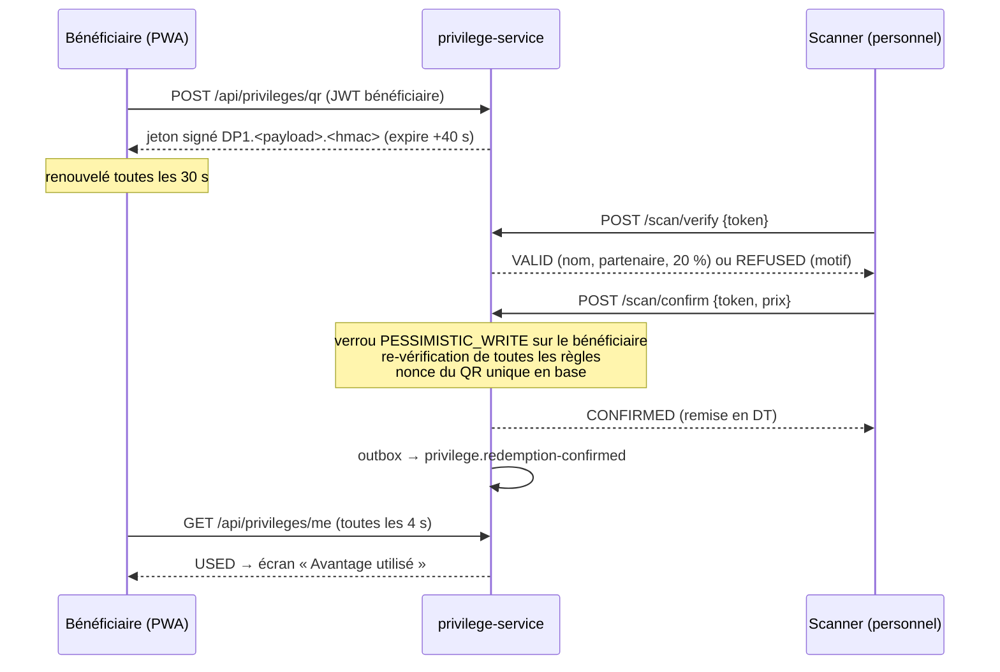
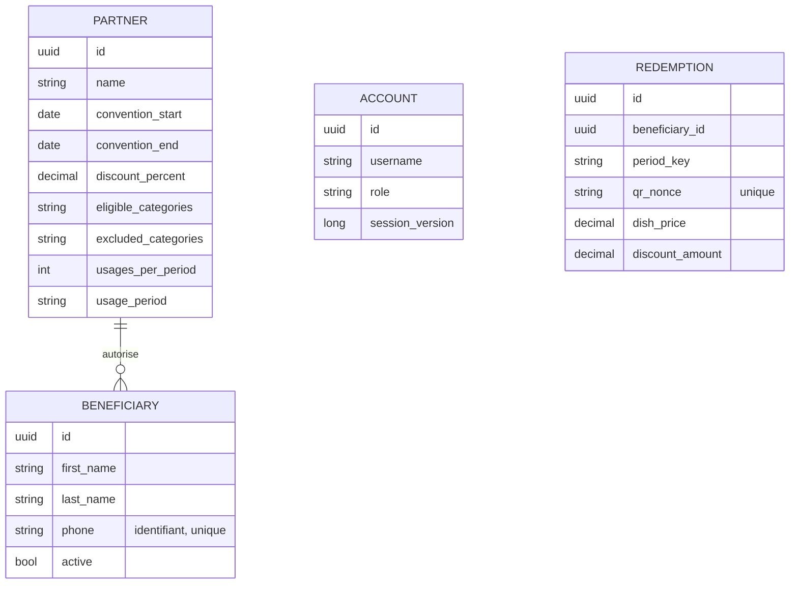

# Architecture technique

## Découpage en microservices

| Service | Responsabilité (bounded context) | Côté écriture | Côté lecture | Schéma |
|---|---|---|---|---|
| `gateway` | Point d'entrée unique, routage, CORS | — | — | — |
| `identity-service` | Comptes (admin, personnel, bénéficiaires), connexion, JWT, sessions, blocage | `Account`, `RefreshSession` | `/api/auth/me`, liste des comptes | `identity` |
| `partner-service` | Partenaires, conventions, règles d'avantage, catégories, bénéficiaires, import | `Partner`, `Beneficiary`, `MenuCategory` | recherche, exports | `partner` |
| `privilege-service` | QR code du jour, contrôle et validation en caisse, API caisse (`/api/pos/v1`) | `Redemption`, `PosTerminal`, `PosReservation`, `PosProduct` | espace bénéficiaire | `privilege` |
| `reporting-service` | Statistiques, journal des passages / refus / actions, exports | — | tables `rpt_*` | `reporting` |

Chaque service possède ses données : aucun service ne lit le schéma d'un autre. Les informations nécessaires sont
répliquées par événements (ex. `privilege-service` garde une copie locale des partenaires et bénéficiaires pour
valider un passage sans appel réseau, en moins de 5 secondes).

## CQRS

```
HTTP ──► Controller ──► CommandBus ──► CommandHandler ──► agrégat JPA ──► EventPublisher (outbox) ─┐
                    └─► QueryBus   ──► QueryHandler   ──► modèle de lecture                          │
                                                                                                     ▼
                                   OutboxRelay (1 s) ──► RabbitMQ topic "damascino.events" ──► projecteurs
```

- `common/cqrs` : `Command<R>`, `Query<R>`, `CommandHandler`, `QueryHandler`, `CommandBus`, `QueryBus`
  (résolution du handler par type générique).
- Les handlers de commande portent la transaction et publient leurs événements dans la table `outbox_event` de la
  même transaction (`EventPublisher`, propagation `MANDATORY`).
- `OutboxRelay` publie les événements en attente dans l'ordre de création ; en cas d'indisponibilité du broker ils
  restent en base et sont renvoyés.
- Les consommateurs sont idempotents (upserts, `on conflict do nothing` sur l'identifiant d'événement) ; les
  messages en échec après 5 tentatives partent dans une file `*.dlq`.

## Événements

| Événement (routing key) | Émetteur | Consommateurs | Contenu |
|---|---|---|---|
| `partner.changed` | partner | privilege, reporting | instantané complet du partenaire et de sa règle |
| `beneficiary.changed` | partner | identity, privilege, reporting | instantané du bénéficiaire |
| `beneficiary.credentials-issued` | partner | identity | hash bcrypt du mot de passe temporaire |
| `identity.account-activated` | identity | partner, reporting | première connexion réussie avec changement de mot de passe |
| `identity.beneficiary-session-changed` | identity | privilege | nouvelle version de session (connexion sur un autre appareil) |
| `privilege.redemption-confirmed` | privilege | reporting | passage validé (bénéficiaire, partenaire, personnel, montants) |
| `privilege.redemption-rejected` | privilege | reporting | refus au scanner ou en caisse avec motif |
| `privilege.redemption-cancelled` | privilege | reporting | passage annulé (ticket annulé ou remboursé en caisse) |
| `audit.recorded` | identity, partner | reporting | action d'administration (auteur, action, objet) |

`POST /api/partners/republish` réémet tous les instantanés pour reconstruire les modèles de lecture.

## Parcours de validation d'un passage



Contrôles effectués (côté serveur, à la vérification **et** à la confirmation) : signature du QR, expiration, nonce
non utilisé, session courante, bénéficiaire connu et actif, partenaire actif, convention en cours, quota de la
période non atteint (jour / semaine / mois, fuseau Africa/Tunis).

## Intégration caisse

Le logiciel de caisse appelle `privilege-service` (via la gateway) avec une clé d'API par poste
(`X-Api-Key`, hachée SHA-256 en base, révocable). `preview` vérifie le QR comme le scanner, choisit la ligne remisée
(`DiscountCalculator`) et crée une `PosReservation` qui compte dans le quota tant que le ticket est ouvert (15 min) ;
`confirm` la transforme en `Redemption` (canal `POS`, n° de ticket, plat) ; `cancel` annule la réservation ou le
passage. Les quotas et l'usage unique des QR codes sont centralisés dans `QuotaService`, partagé par le scanner,
l'espace bénéficiaire et la caisse. Détails pour l'éditeur : [INTEGRATION_CAISSE.md](INTEGRATION_CAISSE.md).

## Sécurité

- Jetons d'accès JWT HS256 de 15 min + jeton de rafraîchissement opaque (haché SHA-256 en base) avec rotation ;
  durée de session : 180 jours pour les bénéficiaires, 12 h pour le personnel et l'administration.
- Session unique bénéficiaire : chaque connexion incrémente `sessionVersion`, supprime les autres sessions et
  invalide immédiatement les QR générés par l'ancien appareil.
- Mots de passe bcrypt (coût 10 ; coût 8 pour les mots de passe temporaires, remplacés à la première connexion),
  8 caractères minimum, PIN de 4 à 8 chiffres pour le personnel, blocage 15 min après 5 échecs.
- Mots de passe temporaires chiffrés AES-256-GCM dans `partner-service` uniquement jusqu'à l'activation du compte
  (export des accès), puis effacés.
- Chaque service vérifie lui-même le JWT et les rôles (`ADMIN`, `STAFF`, `BENEFICIARY`).
- Données personnelles limitées au nom, prénom, téléphone et partenaire.

### Protections web (XSS, injection, force brute)

| Couche | Protection |
|---|---|
| Pages (Next.js, `src/middleware.ts`) | **Content-Security-Policy avec nonce** renouvelé à chaque requête (`script-src 'nonce-…' 'strict-dynamic'`) : un script injecté ou un attribut `onerror=` ne s'exécute pas. `object-src 'none'`, `base-uri 'self'`, `form-action 'self'`, `connect-src 'self'`, `frame-ancestors 'none'`. |
| Pages (`next.config.mjs`) | `X-Frame-Options: DENY` (anti-clickjacking), `X-Content-Type-Options: nosniff`, `Strict-Transport-Security`, `Cross-Origin-Opener-Policy: same-origin`, `Referrer-Policy`, `Permissions-Policy` (caméra limitée au site, micro, géolocalisation, paiement, USB interdits). |
| Rendu | React échappe toutes les données affichées ; aucun `dangerouslySetInnerHTML` dans le code. |
| API (gateway, `SecurityHeadersFilter`) | Réponses JSON et fichiers : `Content-Security-Policy: default-src 'none'; sandbox`, `nosniff`, `X-Frame-Options: DENY`, `Cache-Control: no-store` (données personnelles jamais en cache), `Cross-Origin-Resource-Policy: same-origin`. |
| Saisies (tous les services, `SafeTextJsonConfig`) | Chaque texte des requêtes JSON est contrôlé : **balises HTML et URL `javascript:` refusées** (400 `VALIDATION_ERROR` sur le champ, message « Contenu non autorisé »), caractères invisibles et d'inversion de sens supprimés. Mots de passe, PIN, jetons et clés ne sont jamais modifiés. Même contrôle sur les lignes des imports Excel / CSV (ligne ignorée avec le motif). |
| Exports CSV (`TabularExport`) | **Injection de formule** neutralisée : une cellule commençant par `=`, `+`, `-`, `@` est préfixée d'une apostrophe (les nombres comme `+21698123456` restent intacts). Les exports Excel écrivent du texte, jamais des formules. |
| Connexion (gateway, `LoginThrottleFilter`) | Après **100 échecs de connexion en 10 min depuis une même adresse**, les tentatives suivantes reçoivent 429 : freine le test d'un mot de passe sur de nombreux comptes, en plus du blocage de 15 min par compte après 5 échecs. Réglable : `SECURITY_LOGIN_THROTTLE_MAX_FAILURES`, `SECURITY_LOGIN_THROTTLE_WINDOW`. L'adresse est celle transmise par le proxy d'entrée (`X-Forwarded-For`, posé par Caddy) : exposer le front derrière un proxy qui l'écrase. |
| Taille des requêtes (gateway, `RequestSizeFilter`) | Requêtes de plus de 12 Mo refusées (413) ; `SECURITY_MAX_REQUEST_SIZE`. |
| Base de données | Requêtes JPA paramétrées uniquement (pas de SQL construit par concaténation). |

## Modèle de données (extrait)



Le modèle est prêt pour les évolutions du §16 (pourcentages par profil, fidélité, campagnes) : les règles sont
portées par le partenaire et diffusées en instantanés, et chaque passage conserve le pourcentage appliqué.
