# Damascino Privilèges — Manuel d'utilisation

Version 1.0 · Programme d'avantages Damascino : **−20 % sur un plat éligible par jour** pour les collaborateurs des
entreprises partenaires, avec un **QR code personnel** renouvelé toutes les 30 secondes.

---

## Sommaire

- [0. Présentation](#0-présentation)
- [Partie 1 — Administrateur Damascino](#partie-1--administrateur-damascino)
  - [1.1 Première connexion](#11-première-connexion)
  - [1.2 Créer les comptes du personnel de caisse](#12-créer-les-comptes-du-personnel-de-caisse)
  - [1.3 Définir les catégories de la carte](#13-définir-les-catégories-de-la-carte)
  - [1.4 Créer un partenaire](#14-créer-un-partenaire)
  - [1.5 Régler l'avantage du partenaire](#15-régler-lavantage-du-partenaire)
  - [1.6 Importer la liste des bénéficiaires](#16-importer-la-liste-des-bénéficiaires)
  - [1.7 Transmettre les accès aux bénéficiaires](#17-transmettre-les-accès-aux-bénéficiaires)
  - [1.8 Gérer les bénéficiaires au quotidien](#18-gérer-les-bénéficiaires-au-quotidien)
  - [1.9 Paramétrer la remise dans la caisse](#19-paramétrer-la-remise-dans-la-caisse)
  - [1.10 Suivre l'activité : tableau de bord et statistiques](#110-suivre-lactivité--tableau-de-bord-et-statistiques)
  - [1.11 Journal des passages et des refus](#111-journal-des-passages-et-des-refus)
  - [1.12 Rapprochement avec la caisse](#112-rapprochement-avec-la-caisse)
  - [1.13 Journal d'administration](#113-journal-dadministration)
  - [1.14 Situations courantes](#114-situations-courantes)
- [Partie 2 — Personnel de caisse (serveurs, caissiers)](#partie-2--personnel-de-caisse-serveurs-caissiers)
- [Partie 3 — Guide du bénéficiaire (à remettre aux collaborateurs)](#partie-3--guide-du-bénéficiaire-à-remettre-aux-collaborateurs)
- [Annexe A — Motifs de refus au scanner](#annexe-a--motifs-de-refus-au-scanner)
- [Annexe B — Modèle de fichier d'import](#annexe-b--modèle-de-fichier-dimport)
- [Annexe C — Aide-mémoire](#annexe-c--aide-mémoire)

---

## 0. Présentation

Damascino Privilèges comporte trois espaces. Les bénéficiaires et le personnel de caisse utilisent **l'application
mobile Damascino Privilèges** (Android, iPhone) ; seule l'administration se fait sur le **site web**.

| Espace | Où | Qui | Pour quoi faire |
|---|---|---|---|
| **Administration** | Site web, `/admin/connexion` | Équipe Damascino | Partenaires, bénéficiaires, règles, comptes, statistiques, exports, rapprochement |
| **Espace personnel** | Application mobile → *Personnel Damascino* | Serveurs et caissiers | Scanner le QR code du client et valider le passage |
| **Espace bénéficiaire** | Application mobile → *Je suis bénéficiaire* | Collaborateurs des partenaires | Afficher son QR code du jour et suivre ses passages |

L'application se télécharge depuis la page d'accueil du site (bouton **Télécharger pour Android**) ou depuis le lien
d'activation du partenaire. Les identifiants de bénéficiaire et de personnel **ne fonctionnent pas sur le site** :
la connexion est refusée avec le message *« Connectez-vous depuis l'application mobile Damascino Privilèges. »*

**Le parcours en bref :**

1. Damascino crée un **partenaire** (ex. Mall of Sfax) et importe la **liste** de ses collaborateurs.
2. Chaque collaborateur installe l'application et saisit **son numéro de téléphone** : s'il figure sur la liste, il
   reçoit un **code par SMS** qui active son compte (voir [docs/SMS.md](../SMS.md)).
3. Il reste connecté sur son téléphone ; un nouveau code n'est demandé qu'en cas de changement de téléphone.
4. Au restaurant, il touche **« Utiliser mon avantage »** : un QR code s'affiche.
5. Le caissier **scanne** le code, saisit le prix du plat, **confirme**, puis applique la remise dans la caisse.
6. L'avantage est consommé pour la journée, et le passage apparaît dans les statistiques.

**Règles par défaut (modifiables par partenaire) :** −20 % sur **un** plat éligible (catégorie Plats, hors boissons et
desserts), **une fois par jour**. Le compteur repart à zéro à minuit, heure de Tunis.

---

## Partie 1 — Administrateur Damascino

### 1.1 Première connexion

1. Ouvrir l'adresse de l'application suivie de **`/admin/connexion`**.
2. Saisir l'identifiant **`admin`** et le mot de passe initial communiqué à l'installation.
3. L'application demande aussitôt un **nouveau mot de passe** (8 caractères minimum) :
   - **Mot de passe temporaire** : le mot de passe initial ;
   - **Nouveau mot de passe** et **Confirmation** : votre mot de passe personnel.
4. Cliquer sur **Enregistrer** : le **Tableau de bord** s'affiche.

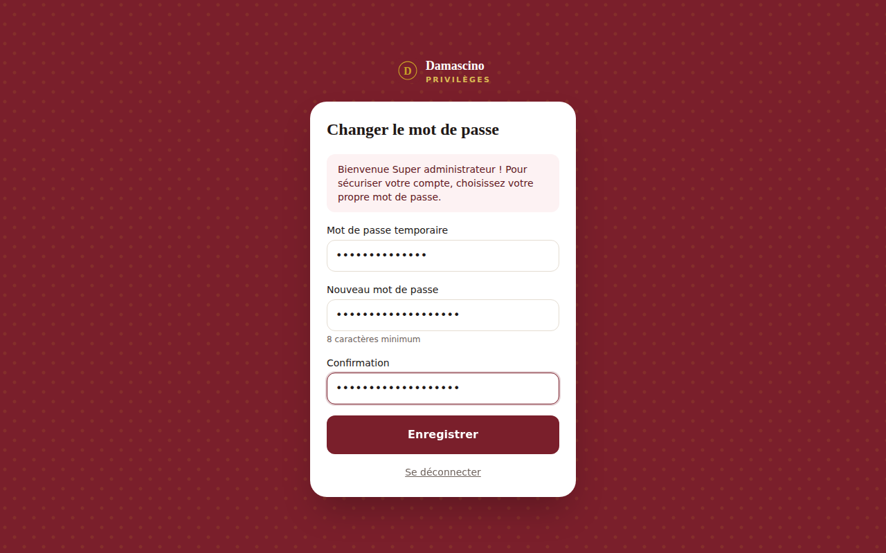

> 🔒 Après 5 essais erronés, le compte est bloqué 15 minutes. Chaque action d'administration est enregistrée dans le
> **Journal** avec votre nom.

Le menu de gauche donne accès à toutes les rubriques : Tableau de bord, Partenaires, Bénéficiaires, Utilisations,
Catégories, Caisses, Rapprochement, Comptes, Journal. Sur téléphone, il s'ouvre avec le bouton **Menu**.

---

### 1.2 Créer les comptes du personnel de caisse

Chaque serveur ou caissier a **son propre compte** : on sait ainsi qui a validé chaque passage.

1. Menu **Comptes** → **Nouveau compte**.
2. **Rôle** : *Personnel scanner (serveur, caissier)*.
3. **Identifiant** : court, en minuscules, commençant par une lettre (ex. `sami`, `caisse1`).
4. **Nom affiché** : tel qu'il apparaîtra dans le journal (ex. *Sami (caisse 1)*).
5. **Code PIN** : 4 à 8 chiffres, à communiquer à la personne.
6. **Créer le compte**.

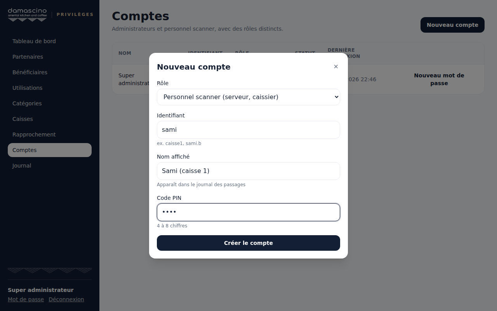

La liste des comptes indique le rôle, le statut (Actif, Bloqué, Désactivé) et la dernière connexion.

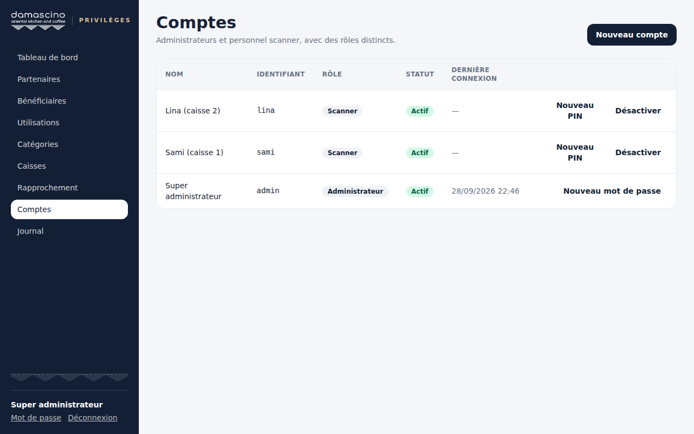

| Pour… | Faire… |
|---|---|
| Donner un nouveau PIN (oubli, compte bloqué) | **Nouveau PIN** sur la ligne → saisir le PIN → **Enregistrer**. Le compte est débloqué et ses sessions ouvertes sont fermées. |
| Retirer l'accès à une personne qui quitte l'entreprise | **Désactiver** (réversible avec **Réactiver**). |
| Créer un autre administrateur | Rôle *Administrateur*, mot de passe provisoire de 8 caractères minimum, changé à sa première connexion. |

---

### 1.3 Définir les catégories de la carte

Les catégories servent à dire **quels plats ouvrent droit à la remise**. Plats, Entrées, Boissons et Desserts
existent déjà.

1. Menu **Catégories**.
2. Saisir un **Libellé** (ex. *Grillades*) → **Ajouter**.
3. Pour supprimer une catégorie : **Supprimer**. C'est impossible tant qu'une règle de partenaire l'utilise.

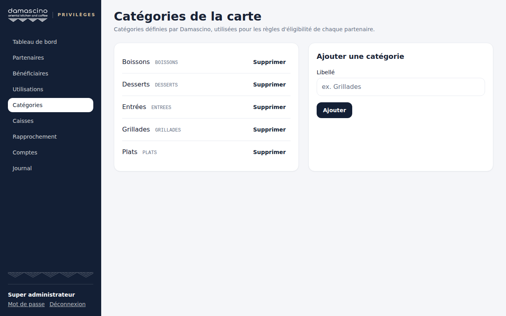

---

### 1.4 Créer un partenaire

1. Menu **Partenaires** → **Nouveau partenaire**.
2. Renseigner :
   - **Nom du partenaire** (ex. *Mall of Sfax*) ;
   - **Début** et **Fin de convention** : l'avantage ne fonctionne qu'entre ces dates ;
   - **Contact**, **Téléphone** et **E-mail du contact** (facultatifs).
3. **Enregistrer** : la fiche du partenaire s'ouvre.

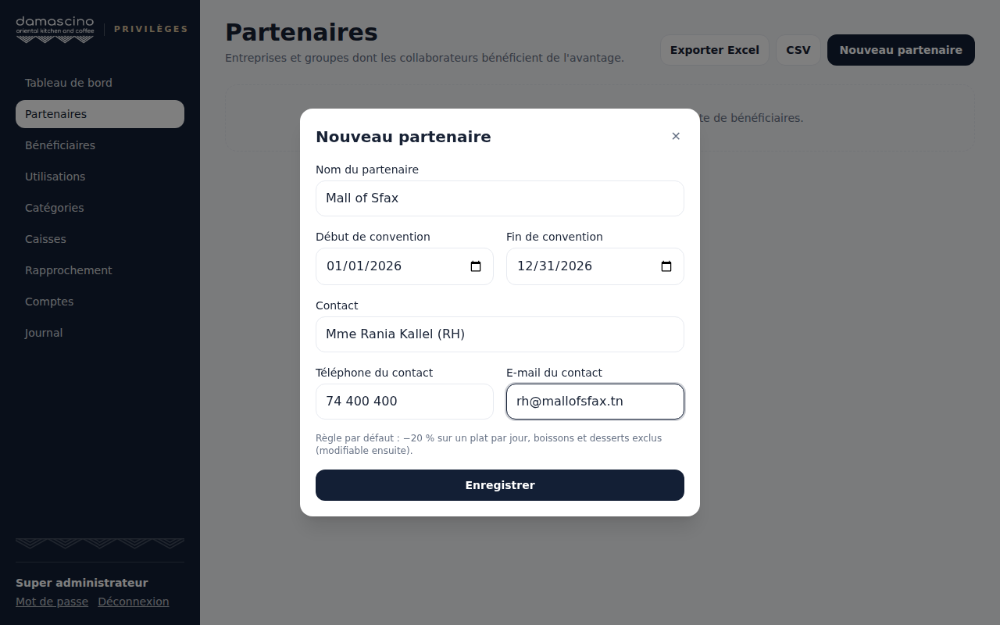

Le partenaire reçoit automatiquement la **règle V1** : −20 %, 1 plat par jour, Plats éligibles, Boissons et Desserts
exclus.

La liste des partenaires montre le statut (*En cours*, *Hors convention*, *Inactif*), la règle, et les nombres de
bénéficiaires et de comptes activés.

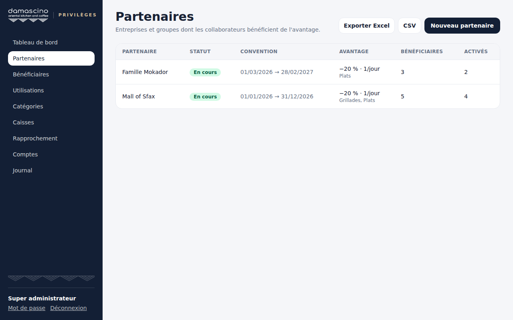

**Sur la fiche du partenaire :**
- **Modifier** : nom, contact, dates de convention ;
- **Désactiver** / **Activer** : suspend ou rétablit l'avantage de tous ses bénéficiaires ;
- **Lien d'activation** : page de connexion au nom du partenaire, à lui transmettre (**Copier le lien**).

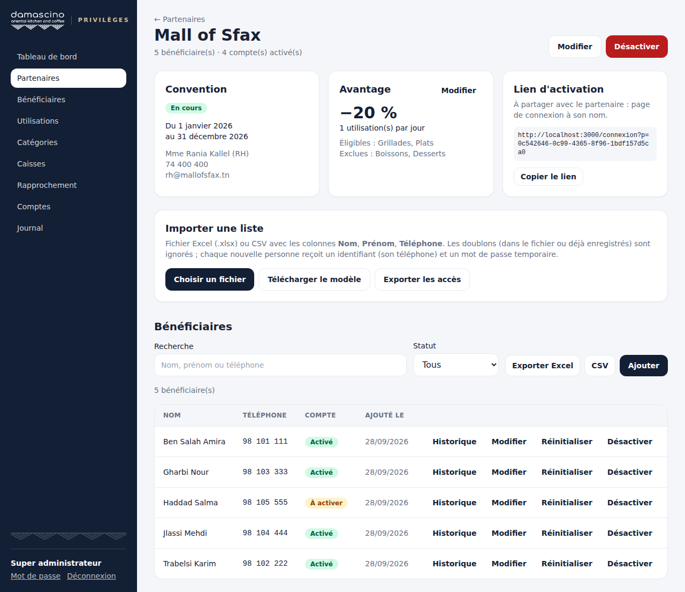

---

### 1.5 Régler l'avantage du partenaire

1. Fiche du partenaire → carte **Avantage** → **Modifier**.
2. Régler :
   - **Remise (%)** (ex. 20) ;
   - **Utilisations** et **Par** : nombre de passages autorisés par *jour*, *semaine* ou *mois* ;
   - **Catégories** : pour chacune, **Éligible**, **—** (neutre) ou **Exclue**.
3. **Enregistrer la règle**. Elle s'applique immédiatement.

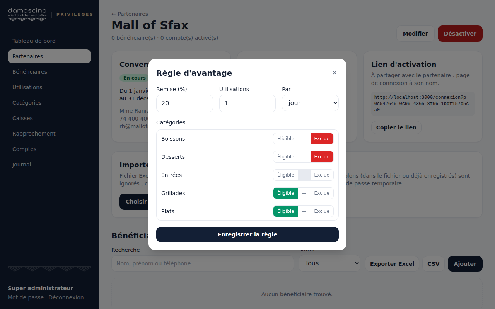

> Au moins une catégorie doit être éligible, et une catégorie ne peut pas être à la fois éligible et exclue.

---

### 1.6 Importer la liste des bénéficiaires

Seules les personnes importées dans la liste d'un partenaire actif reçoivent des accès : **il n'y a pas d'inscription
libre**.

1. Fiche du partenaire → **Télécharger le modèle** : fichier Excel avec les colonnes **Nom**, **Prénom**,
   **Téléphone** (voir [Annexe B](#annexe-b--modèle-de-fichier-dimport)).
2. Remplir le modèle, ou utiliser le fichier du partenaire s'il a ces trois colonnes (Excel `.xlsx` ou CSV).
3. **Choisir un fichier** → sélectionner le fichier. L'import est immédiat.
4. Lire le compte rendu :
   - **« N bénéficiaire(s) créé(s) »** : chacun a reçu un identifiant (son téléphone) et un mot de passe temporaire ;
   - **« lignes ignorées »**, avec le motif : doublon dans le fichier, déjà enregistré, déjà inscrit chez un autre
     partenaire, téléphone invalide, nom manquant.

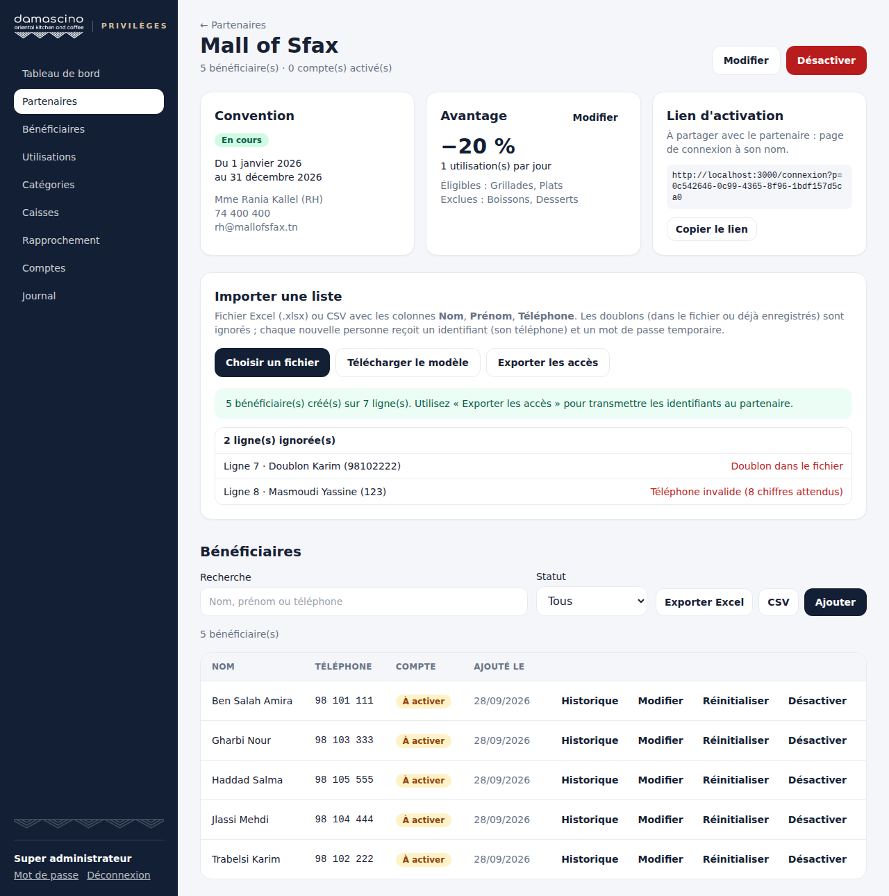

> Le téléphone peut être écrit avec ou sans espaces ou indicatif (`98 123 456`, `+216 98123456`) : il est enregistré
> sur 8 chiffres. **Un numéro = un seul partenaire.**

Réimporter la liste mise à jour est sans risque : les personnes déjà présentes sont ignorées et seules les nouvelles
sont créées.

---

### 1.7 Transmettre les accès aux bénéficiaires

1. Fiche du partenaire → **Exporter les accès** : fichier Excel avec *Nom, Prénom, Identifiant (téléphone), Mot de
   passe temporaire, Statut*.
2. Envoyer ce fichier au responsable du partenaire (RH), qui remet à chaque collaborateur son identifiant et son mot
   de passe temporaire.
3. Joindre le **lien d'activation** (fiche du partenaire → *Copier le lien*) et la
   [Partie 3](#partie-3--guide-du-bénéficiaire-à-remettre-aux-collaborateurs) de ce manuel. Le lien ouvre une page
   au nom du partenaire qui explique comment **télécharger l'application** et s'y connecter.

> Le mot de passe temporaire reste disponible dans l'export **jusqu'à la première connexion** du bénéficiaire. Ensuite
> la ligne indique *« Compte activé le … »* et le mot de passe n'est plus consultable par personne.

Pour une seule personne (ajout ou réinitialisation), l'application affiche l'accès dans une fenêtre :
**Copier le message** prépare un texte prêt à envoyer par SMS ou WhatsApp.

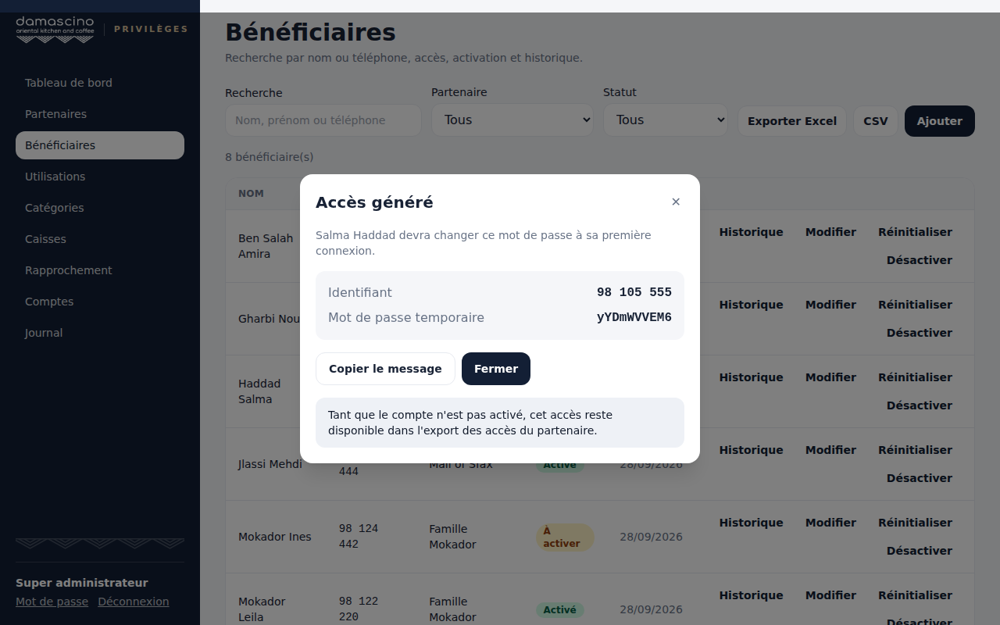

---

### 1.8 Gérer les bénéficiaires au quotidien

Menu **Bénéficiaires**, ou fiche d'un partenaire → section **Bénéficiaires**.

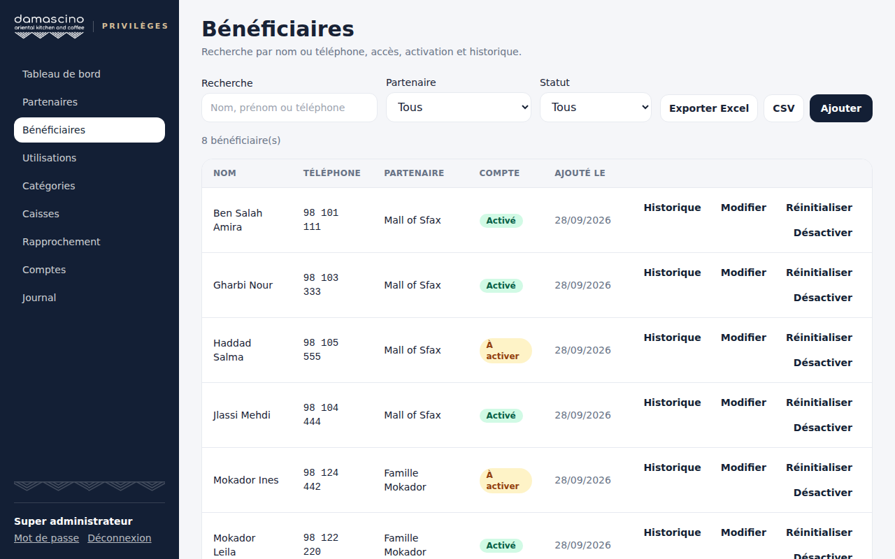

| Pour… | Faire… |
|---|---|
| **Rechercher** | Taper un nom, un prénom ou une partie du téléphone ; filtrer par partenaire et par statut. |
| **Ajouter une personne** | **Ajouter** → partenaire, nom, prénom, téléphone → **Ajouter et générer les accès** → transmettre l'accès affiché. |
| **Corriger un nom ou un téléphone**, changer de partenaire | **Modifier** → **Enregistrer**. Le nouvel identifiant est le nouveau téléphone. |
| **Mot de passe oublié** | **Réinitialiser** → confirmer → transmettre le nouveau mot de passe temporaire. Le compte est débloqué et l'ancien téléphone déconnecté. |
| **Départ du collaborateur** | **Désactiver**. Il ne peut plus se connecter, et un QR présenté est refusé. **Réactiver** le rétablit. |
| **Voir ses passages** | **Historique** : date, heure, remise, membre du personnel. |
| **Exporter la liste** | **Exporter Excel** ou **CSV** (tient compte de la recherche et des filtres). |

Colonne **Compte** : *À activer* (jamais connecté), *Activé* (mot de passe personnel choisi), *Désactivé*.

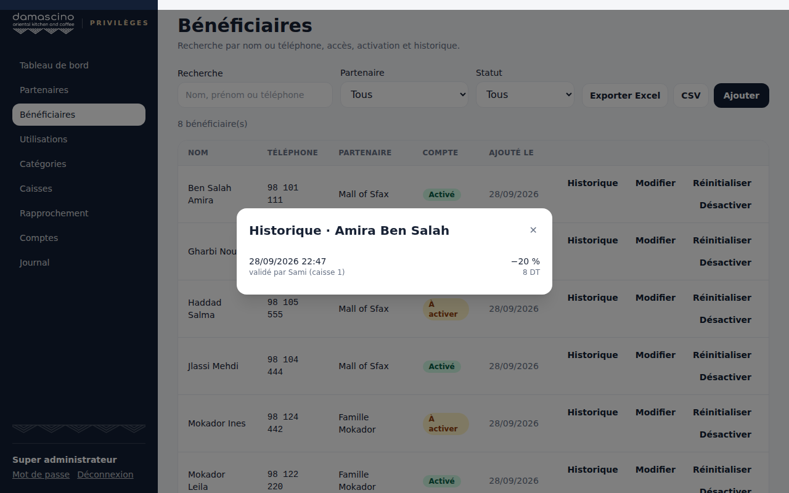

---

### 1.9 Paramétrer la remise dans la caisse

Le caissier valide le QR code avec l'Espace personnel, puis **applique la remise dans la caisse existante**, rubrique
**Remise**. Ce paramétrage indique à la tablette quoi lui faire saisir.

1. **Dans la caisse** (une fois) : créer une remise nommée, par exemple *« Damascino Privilèges »*, de préférence
   **en % sur une ligne**.
2. **Dans l'application** : menu **Caisses** → bloc **Remise saisie dans la caisse** :
   - **Nom de la remise dans la caisse** : exactement le même nom que dans la caisse ;
   - **Comment la caisse applique la remise** : *En % sur la ligne du plat*, ou *En montant sur le ticket* si la caisse
     ne sait remiser que le ticket entier ;
   - **Prix du plat obligatoire sur la tablette** : recommandé, et indispensable en mode « montant » ;
   - **Enregistrer**.

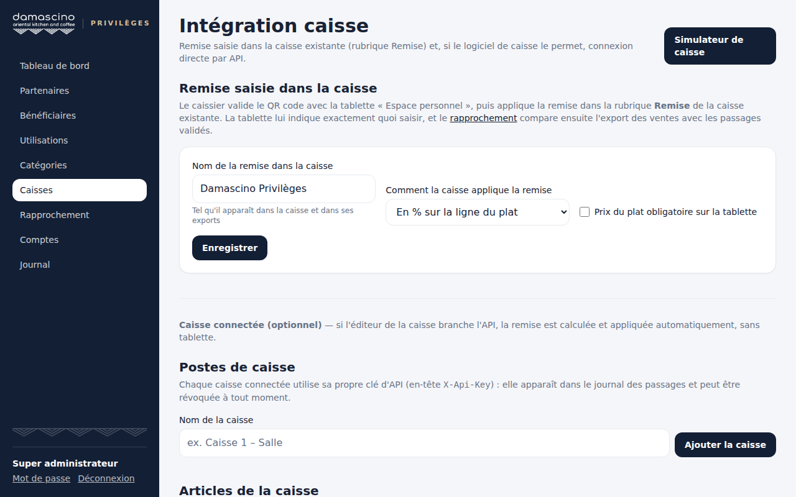

> La partie **Caisse connectée (optionnel)** de la même page ne sert que si l'éditeur du logiciel de caisse branche
> l'API Damascino Privilèges. Voir `docs/INTEGRATION_CAISSE.md`.

---

### 1.10 Suivre l'activité : tableau de bord et statistiques

Menu **Tableau de bord**.

1. Choisir le **Partenaire** (ou *Tous*) et la **période** (dates, ou raccourcis *Aujourd'hui*, *7 jours*,
   *30 jours*, *12 mois*).
2. Lire les indicateurs :

| Indicateur | Signification |
|---|---|
| **Autorisés** | Bénéficiaires actifs |
| **Comptes activés** | Bénéficiaires qui ont choisi leur mot de passe (et % des autorisés) |
| **Utilisateurs actifs** | Bénéficiaires ayant au moins un passage sur la période |
| **Passages** | Avantages validés en caisse (et nombre de refus) |
| **Remises accordées** | Total des remises en dinars, et total des plats remisés (si le prix est saisi) |

3. Le graphique **Passages par jour** et le tableau **Par partenaire** détaillent l'activité.
4. **Exporter Excel** / **CSV** : tableau par partenaire. Les boutons du graphique exportent le détail par jour.

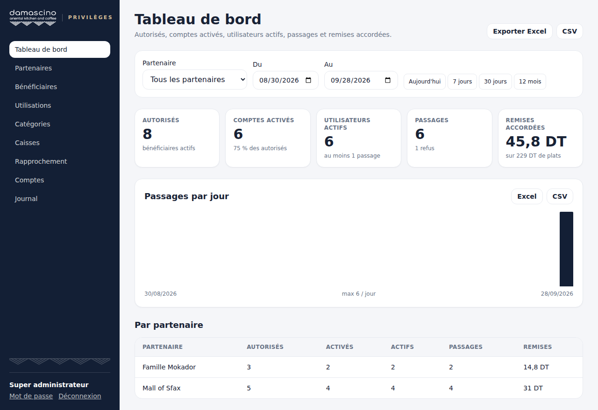

---

### 1.11 Journal des passages et des refus

Menu **Utilisations**, avec les mêmes filtres partenaire et période.

- Onglet **Passages** : date et heure, bénéficiaire, partenaire, validé par, plat et prix, remise, n° de ticket et
  **code de validation**. Un passage annulé en caisse est marqué *Annulé* et ne compte plus.
- Onglet **Refus** : chaque QR refusé au scanner, avec son motif (voir [Annexe A](#annexe-a--motifs-de-refus-au-scanner)).
- **Exporter Excel** / **CSV** : export de l'onglet affiché.

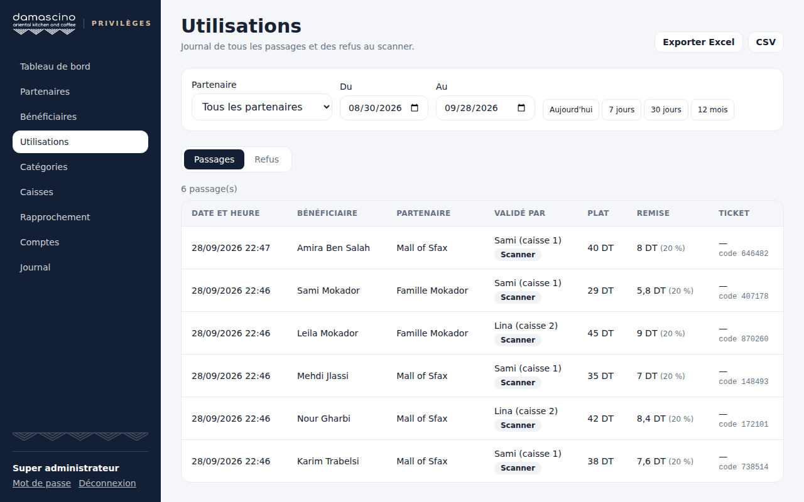

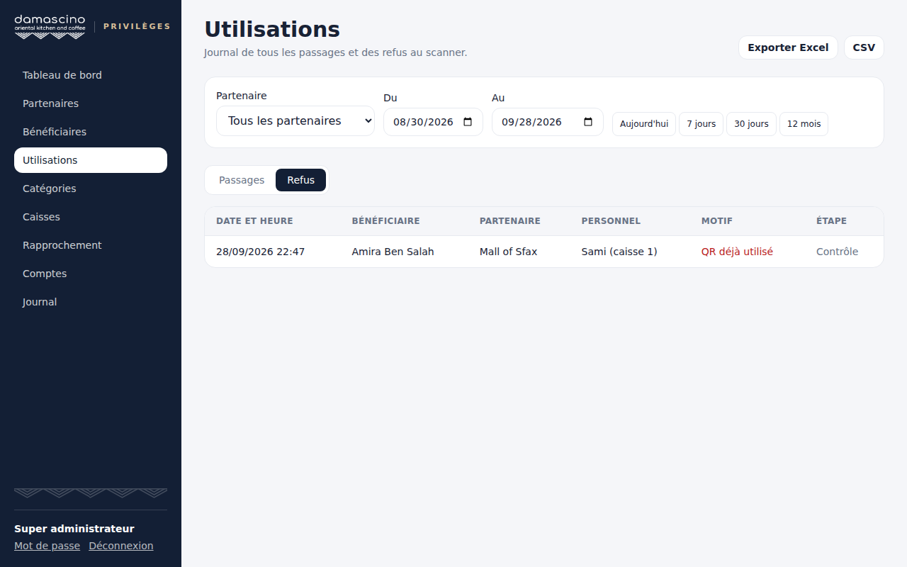

---

### 1.12 Rapprochement avec la caisse

À faire chaque jour, ou chaque semaine, pour vérifier que **chaque remise saisie dans la caisse correspond à un QR
code validé**, et inversement.

1. Dans le logiciel de caisse, **exporter les ventes** de la période (Excel ou CSV).
2. Menu **Rapprochement** → **Choisir l'export** → sélectionner le fichier.
3. Vérifier les **colonnes** reconnues automatiquement, et les corriger si besoin :
   - **Date et heure**, ou **Date** + **Heure** ;
   - **Montant de la remise** (obligatoire) ;
   - **Libellé de la remise** : pour ne garder que les remises Damascino et ignorer les autres (happy hour…) ;
   - **Commentaire / référence** : là où le caissier note le code de validation ;
   - **N° de ticket** et **Caissier** (facultatifs).
4. Vérifier le **Nom de la remise Damascino** et la **Tolérance horaire** (30 min par défaut).
5. **Lancer le rapprochement**.

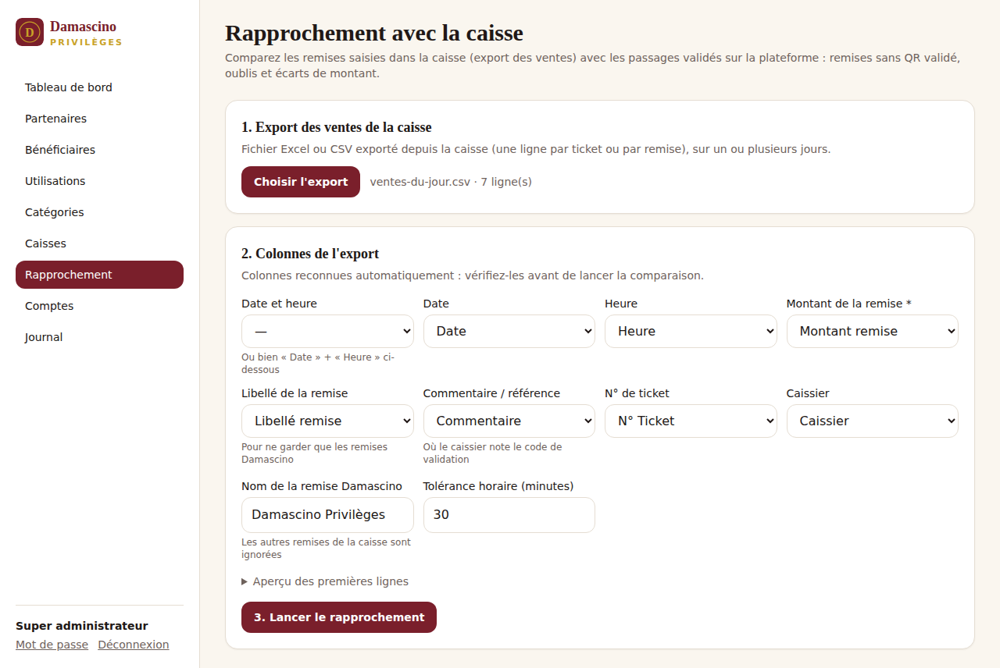

**Lire le résultat :**

| Bloc | Signification | Action |
|---|---|---|
| 🔴 **Remises en caisse sans passage validé** | Remise saisie sans QR code valide | Vérifier avec le caissier concerné |
| 🟠 **Passages validés sans remise en caisse** | QR validé mais remise oubliée (ou saisie sous un autre nom) | Rappeler la procédure au personnel |
| 🟠 **Écarts de montant** | Remise saisie ≠ remise validée | Vérifier le ticket |
| **Rapprochés** | Correspondance trouvée : par *code de validation*, *n° de ticket* ou *heure et montant* | — |

**Exporter les anomalies (CSV)** produit la liste à traiter. Aucun fichier n'est conservé sur le serveur.

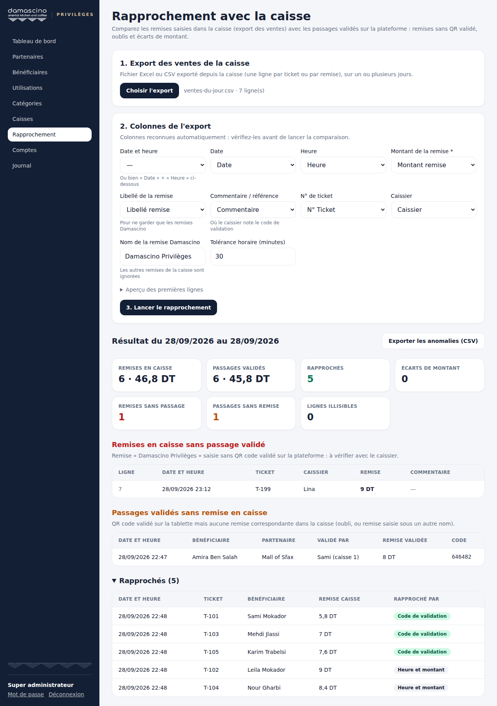

---

### 1.13 Journal d'administration

Menu **Journal** : chaque action (création de partenaire, import, modification de règle, réinitialisation,
création de compte…) avec sa **date**, son **auteur** et le **détail**. Une recherche permet de filtrer, et
**Exporter Excel** / **CSV** exporte le journal.

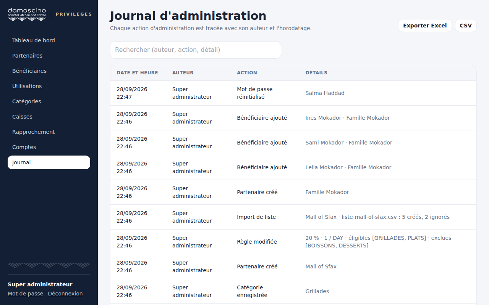

---

### 1.14 Situations courantes

| Situation | Que faire |
|---|---|
| Un collaborateur a **oublié son mot de passe** | Bénéficiaires → rechercher → **Réinitialiser** → transmettre le nouvel accès. |
| Un collaborateur **change de numéro** | Bénéficiaires → **Modifier** → nouveau téléphone. Son identifiant devient le nouveau numéro, son mot de passe ne change pas. |
| Un collaborateur **quitte le partenaire** | **Désactiver**. |
| Le partenaire envoie une **liste mise à jour** | Réimporter : seuls les nouveaux sont créés. Désactiver ensuite les partants. |
| **Fin de convention** d'un partenaire | Rien à faire : après la date de fin, l'avantage affiche *Convention expirée*. Pour prolonger : fiche → **Modifier** → nouvelle date de fin. |
| **Suspendre** un partenaire immédiatement | Fiche → **Désactiver**. |
| Un caissier a **oublié son PIN** ou est **bloqué** | Comptes → **Nouveau PIN**. |
| « Service en cours de démarrage » | Le serveur démarre (ex. après une mise à jour) : réessayer dans une minute. |

---

## Partie 2 — Personnel de caisse (serveurs, caissiers)

Matériel : un **téléphone ou une tablette Android ou iPhone** avec caméra, près de la caisse, sur lequel est installée
l'application **Damascino Privilèges** (bouton *Télécharger pour Android* de la page `/personnel` du site).

### 2.1 Se connecter

1. Ouvrir l'application et toucher **Personnel Damascino**. À la première ouverture du scanner, **autoriser
   l'accès à la caméra**.
2. Saisir **votre** identifiant et **votre** code PIN. Chaque validation est enregistrée à votre nom : ne
   partagez pas votre PIN.
3. **Se connecter**. L'écran du scanner s'ouvre.

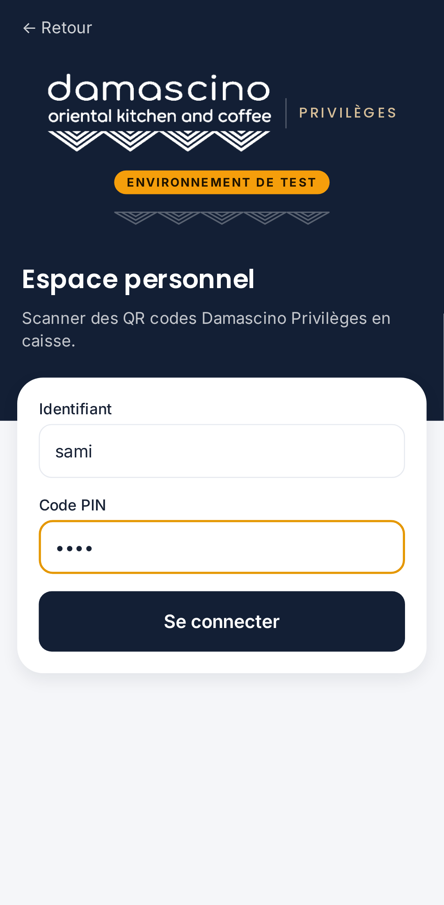

> ⏱ Sans activité pendant **5 minutes**, le scanner se déconnecte automatiquement.

### 2.2 Valider l'avantage d'un client, étape par étape

**Étape 1 — Scanner.** Le client affiche son QR code (bouton *Utiliser mon avantage*). Placez-le dans le cadre de
la caméra : la lecture est automatique. Si la caméra ne fonctionne pas, utilisez **Saisie manuelle du code**.

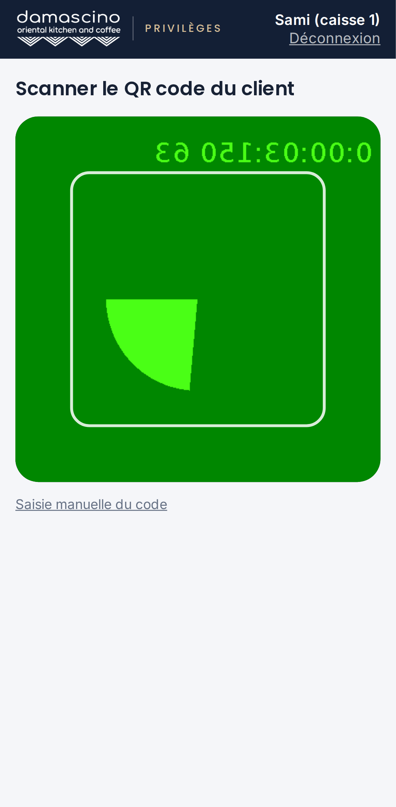

**Étape 2 — Vérifier l'écran vert « Avantage valide ».**
- **Comparez le nom affiché avec le client** : l'accès est personnel.
- L'écran indique le partenaire, la remise (−20 % sur 1 plat éligible) et les catégories (ex. Plats, hors Boissons et
  Desserts).

**Étape 3 — Saisir le prix du plat remisé** (ex. `40`) : la remise est calculée (ex. *Remise : 8 DT*). Si la
commande contient plusieurs plats éligibles, prenez **un seul** plat, en principe le plus cher.

**Étape 4 — Confirmer le passage.** Le code devient invalide et l'avantage du client est consommé pour la journée.

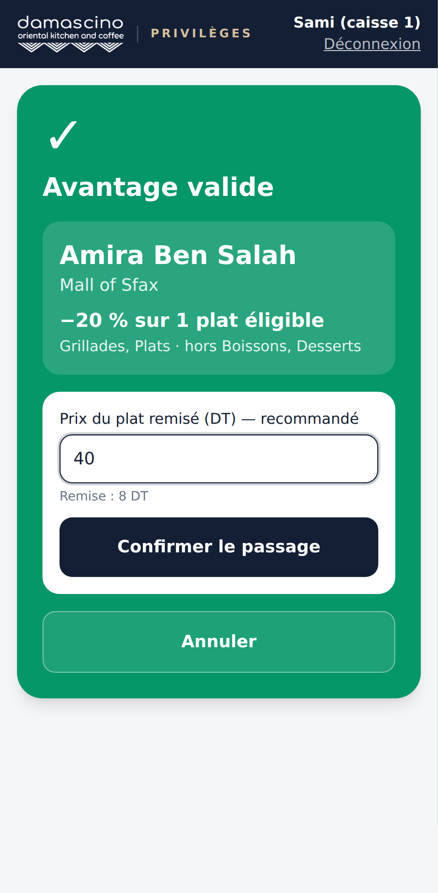

**Étape 5 — Saisir la remise dans la caisse.** L'écran **« Passage validé »** indique exactement quoi faire :
1. rubrique **Remise** → la remise « Damascino Privilèges » ;
2. **20 % sur la ligne du plat**, ou le **montant** indiqué, selon le paramétrage ;
3. **code de validation** à 6 chiffres, à noter dans le **commentaire du ticket** si la caisse le permet.

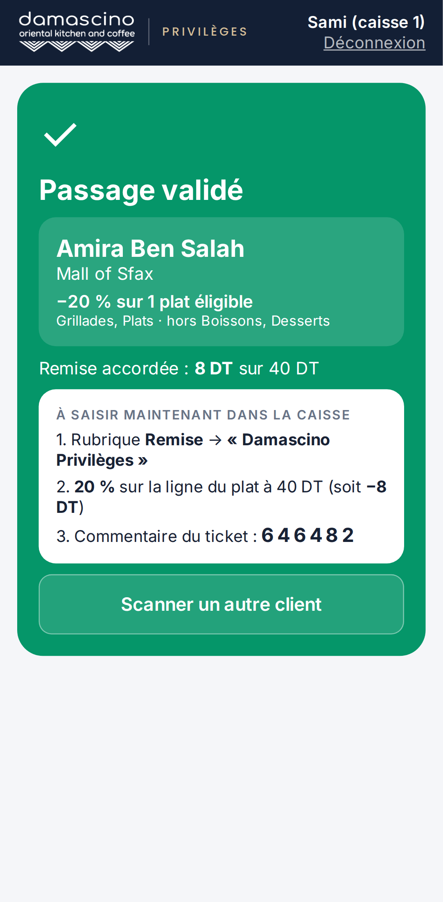

**Étape 6 — Scanner un autre client.**

> Une fois confirmé, le passage compte pour la journée du client. Si le client repart sans payer, signalez-le à un
> administrateur : il apparaîtra au rapprochement comme « passage validé sans remise en caisse ».

### 2.3 Écran rouge « Refusé »

L'écran rouge indique le **motif**. N'appliquez **aucune remise**.

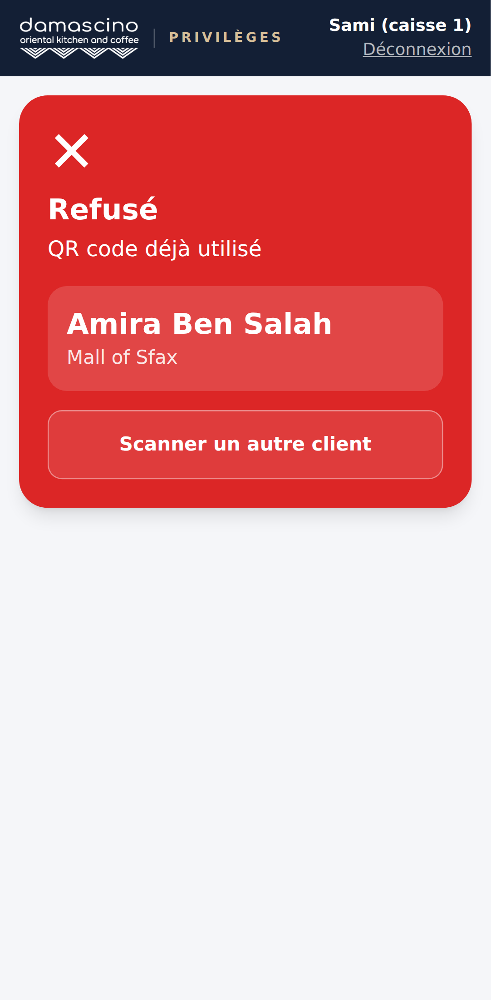

| Motif affiché | Que dire ou faire |
|---|---|
| QR code expiré | « Votre code a changé, montrez l'écran actuel » puis scanner à nouveau. |
| QR code déjà utilisé | Code déjà présenté (photo ou capture d'écran) : demander le code affiché en direct. |
| Avantage déjà utilisé pour cette période | L'avantage du jour a déjà été pris : pas de remise. |
| Compte connecté sur un autre appareil | Le client doit se reconnecter sur son téléphone. |
| Bénéficiaire désactivé / Partenaire inactif / Convention expirée | Pas de remise. Le client peut contacter son entreprise ou Damascino. |
| QR code invalide | Ce n'est pas un QR Damascino Privilèges. |

### 2.4 Bonnes pratiques

- ✅ Vérifiez que l'**heure défile** au-dessus du QR du client et que le compte à rebours diminue : une photo de
  l'écran est figée, et de toute façon refusée.
- ✅ Vérifiez le **nom** du client.
- ✅ Saisissez toujours le **prix du plat** : il sert au calcul des remises et au contrôle avec la caisse.
- ✅ Reportez la remise dans la caisse **immédiatement** après la confirmation.
- ❌ Ne validez jamais sans scanner, et ne saisissez jamais la remise Damascino sans écran vert.

---

## Partie 3 — Guide du bénéficiaire (à remettre aux collaborateurs)

> **Votre avantage Damascino : −20 % sur un plat, chaque jour.**
> Réservé aux collaborateurs des entreprises partenaires de Damascino.

### 3.1 Première connexion (une seule fois)

1. **Installez l'application Damascino Privilèges** : ouvrez sur votre téléphone le lien reçu de votre entreprise,
   puis touchez **Télécharger pour Android** et ouvrez le fichier téléchargé (autorisez l'installation si le
   téléphone le demande). Sur iPhone, suivez le lien App Store ou TestFlight communiqué par Damascino.

   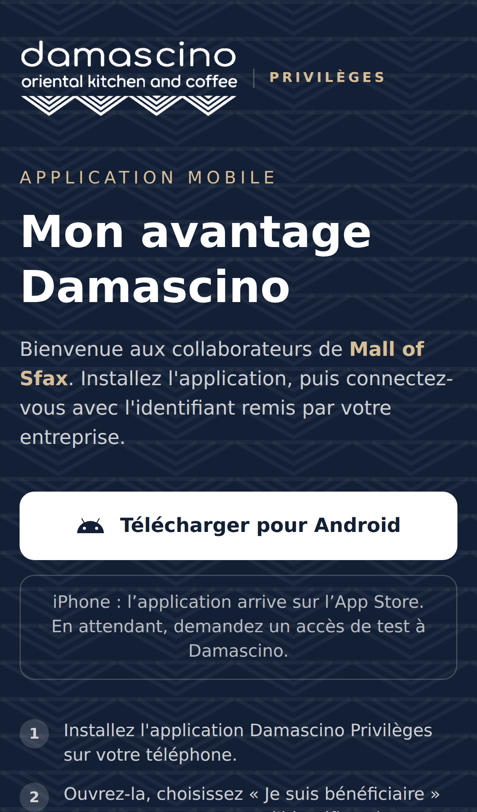

2. Ouvrez l'application et touchez **Je suis bénéficiaire**.

   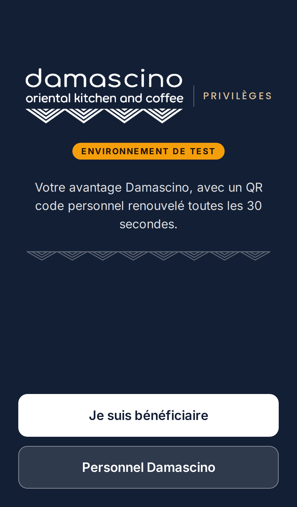

3. Saisissez **votre numéro de téléphone** (celui communiqué à votre entreprise, ex. `98 123 456`) et touchez
   **Recevoir le code par SMS**.
4. Vous recevez un SMS *« Damascino Privileges : votre code est … »*. Saisissez les **6 chiffres** et touchez
   **Valider** : votre compte est activé et votre espace s'affiche.
    - Le code est valable **5 minutes** ; après **3 codes faux**, demandez-en un nouveau (**Renvoyer un code**,
      possible après 60 secondes).
    - Si le numéro n'est pas sur la liste de votre entreprise, l'inscription est refusée : contactez votre service RH.

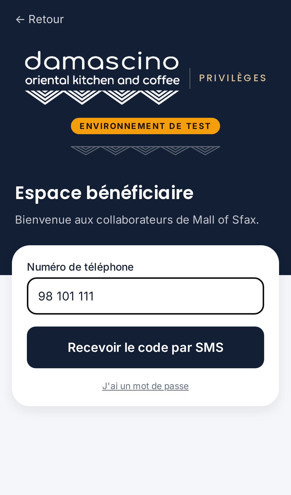 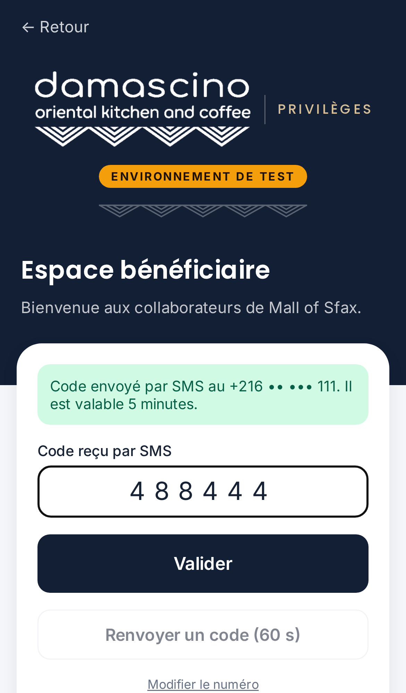

> Votre entreprise vous a remis un mot de passe ? Touchez **J'ai un mot de passe** sous le bouton. Ce mode de secours
> est désactivé dès que vous vous activez par SMS.

### 3.2 Rester connecté

Vous restez connecté : ouvrez simplement l'application **Damascino Privilèges** au moment de payer. Votre session est
conservée de façon sécurisée sur le téléphone. **Un nouveau code SMS n'est demandé qu'en cas de changement de
téléphone** ; l'ancien téléphone est alors déconnecté.

### 3.3 Votre espace

Il affiche votre nom, votre entreprise, votre avantage et sa **disponibilité** :
- **Disponible** : vous pouvez l'utiliser aujourd'hui ;
- **Déjà utilisé aujourd'hui** : de nouveau disponible demain (à minuit) ;
- **Convention expirée** : contactez votre entreprise.

La rubrique **Mes passages** liste vos utilisations.

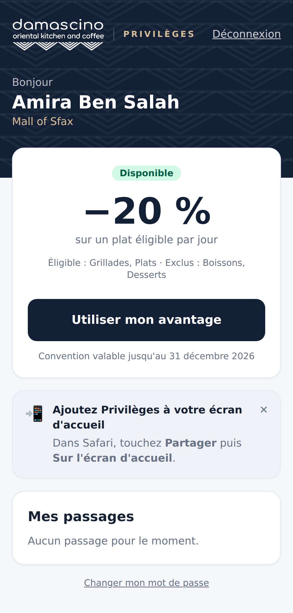

### 3.4 Utiliser votre avantage au restaurant

1. **Au moment de payer**, ouvrez l'application et touchez **Utiliser mon avantage**.
2. Présentez l'écran au caissier. Le QR code **change toutes les 30 secondes** : laissez l'écran ouvert.
3. Le caissier scanne le code et applique **−20 % sur un plat éligible** (Plats ; hors boissons et desserts).
4. Votre écran affiche **« Avantage utilisé »** avec la remise obtenue. Touchez **Terminer**.

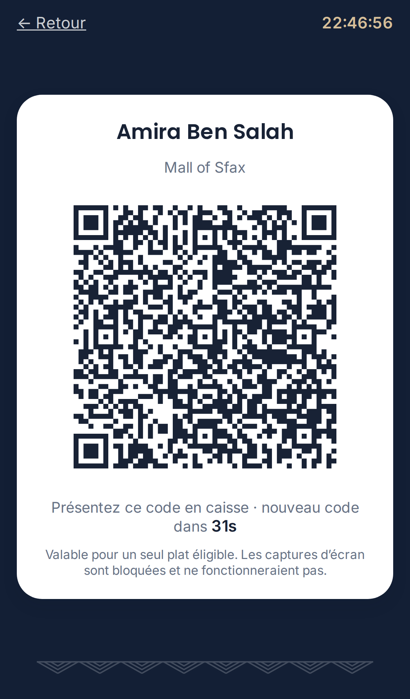 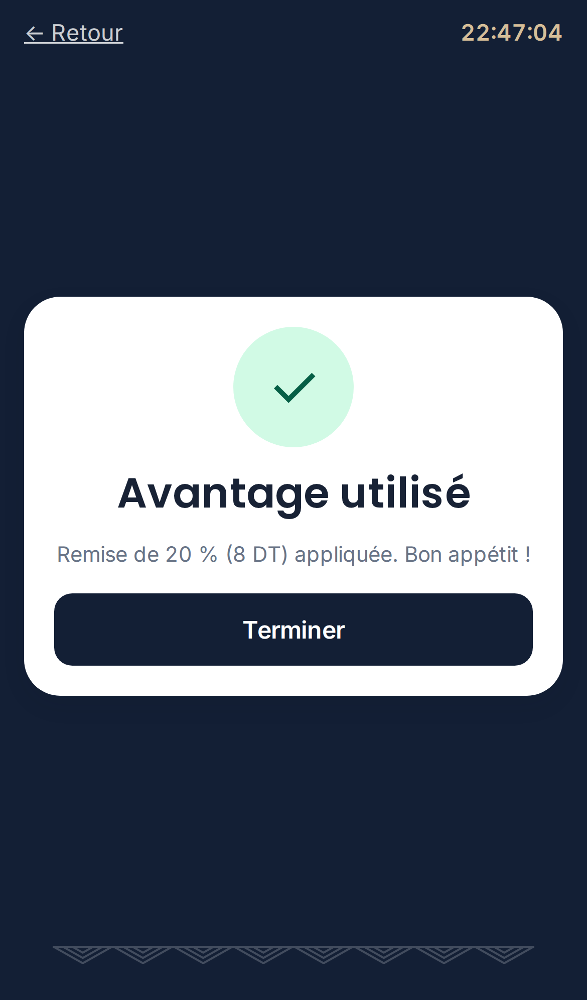

### 3.5 Règles à connaître

- **Un plat éligible par jour** : les boissons et desserts ne sont pas remisés.
- L'avantage est **personnel** : votre nom s'affiche chez le caissier.
- Les **captures d'écran sont bloquées** sur l'écran du QR code, et une photo ne fonctionnerait pas : le code change toutes les 30 secondes et ne sert qu'une fois. L'application met aussi la luminosité au maximum pendant l'affichage du code pour faciliter le scan.
- **Un seul téléphone à la fois** : si vous vous connectez sur un autre appareil, le précédent est déconnecté.
- Une connexion internet (4G ou Wi-Fi) est nécessaire pour afficher le code.

### 3.6 Questions fréquentes

| Question | Réponse |
|---|---|
| Je n'ai pas reçu le SMS | Vérifiez le numéro saisi, puis touchez **Renvoyer un code** après 60 secondes (3 codes par heure au maximum). |
| « Ce numéro ne figure pas sur la liste » | Votre numéro n'a pas été transmis par votre entreprise, ou il a changé : contactez votre service RH. |
| « Trop d'essais incorrects » | Après 3 codes faux, le code est bloqué : demandez-en un nouveau. |
| J'ai changé de téléphone | Installez l'application sur le nouveau téléphone et demandez un code SMS : l'ancien est déconnecté. |
| « Votre compte est connecté sur un autre appareil » | Reconnectez-vous sur le téléphone que vous utilisez. |
| J'ai changé de numéro | Prévenez votre entreprise : votre identifiant sera mis à jour. |
| Le bouton « Utiliser mon avantage » est grisé | L'avantage du jour est déjà utilisé, ou votre convention n'est pas active. |

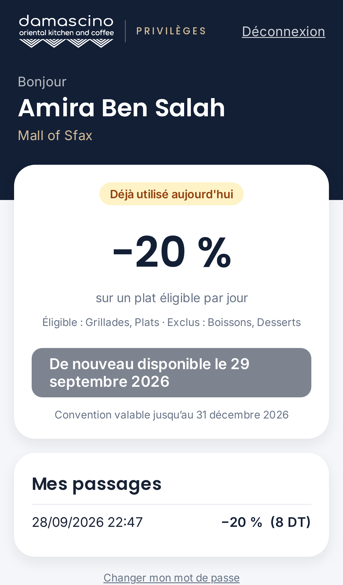

---

## Annexe A — Motifs de refus au scanner

| Motif | Cause |
|---|---|
| QR code invalide | Code falsifié ou d'une autre application |
| QR code expiré | Code de plus de 40 secondes (capture d'écran, écran resté ouvert hors ligne) |
| QR code déjà utilisé | Code déjà validé une fois |
| Compte connecté sur un autre appareil | Connexion plus récente sur un autre téléphone |
| Compte inconnu | Bénéficiaire non enregistré |
| Bénéficiaire désactivé | Désactivé par l'administration |
| Partenaire inactif | Partenaire suspendu |
| Convention pas encore commencée / expirée | Date du jour hors de la période de convention |
| Avantage déjà utilisé pour cette période | Quota atteint (1 par jour par défaut) |

Tous les refus sont visibles dans **Utilisations → Refus**.

## Annexe B — Modèle de fichier d'import

| Nom | Prénom | Téléphone |
|---|---|---|
| Ben Salah | Amira | 98 101 111 |
| Trabelsi | Karim | +216 98 102 222 |

- Excel (`.xlsx`) ou CSV (séparateur `;` ou `,`) ; la ligne d'en-tête est obligatoire, l'ordre des colonnes est libre.
- Les en-têtes sans accents sont acceptés (`Prenom`, `Telephone`, `Tel`, `GSM`).
- 5 000 lignes maximum par fichier.

## Annexe C — Aide-mémoire

| Rôle | Où | Identifiant | Secret |
|---|---|---|---|
| Administrateur | `/admin/connexion` | ex. `admin` | Mot de passe (8 car. min.) |
| Personnel de caisse | Application mobile → *Personnel Damascino* | ex. `sami` | Code PIN (4 à 8 chiffres) |
| Bénéficiaire | Application mobile → *Je suis bénéficiaire* | Numéro de téléphone | Mot de passe (8 car. min.) |

**Au quotidien :** scanner → vérifier le nom → prix du plat → confirmer → saisir la remise dans la caisse (+ code).
**Chaque jour ou chaque semaine :** Rapprochement avec l'export de la caisse.
**Chaque mois :** Tableau de bord → export des statistiques par partenaire.
